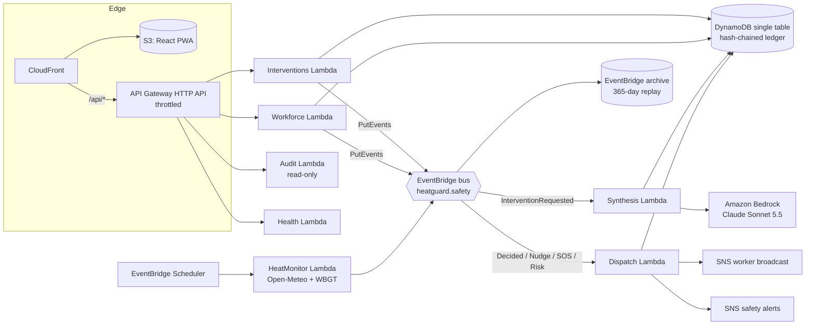

# 🛡️ HeatGuard — Occupational Heat-Risk Intervention & Compliance System
> **Track:** Heat & Water • AI-Assisted Decision Support • AWS Cloud  
> **Built for:** WeMakeDevs Hackathon — Designed to Compete for 1st Place

[](https://vitejs.dev/)
[](https://react.dev/)
[](https://aws.amazon.com/)
[](template.yaml)
[](#)

---

## 🎯 The Core Innovation: Closing the Loop
Most environmental hackathon entries fail because they are **passive dashboards**—showing a red heat index map or sending a generic *"drink water"* push notification that workers and supervisors ignore.

Previous winning patterns (*Suraksha*, *Beacon Night Shift*, *CampusEvac*) succeed because they turn a hazard into an **actionable, human-in-the-loop closed loop**:

```
[ Real-Time Weather Stream ] + [ Site Workload Profile ]
               │
               ▼
   [ Scientific Liljegren WBGT Physical Engine ]
               │
               ▼
   [ Amazon Bedrock Constraint-Aware Optimizer ] ──► [ Concrete Schedule & Logistics Proposal ]
                                                                   │
                                                                   ▼
                                                   [ Supervisor Approval / Override ]
                                                                   │
                                           ┌───────────────────────┴───────────────────────┐
                                           ▼                                               ▼
                              [ Worker Field Directive ]                        [ Live Verification Feed ]
                               • Tamil / Hindi / English                         • 1-Tap Shade & Water Check-ins
                               • Web Speech API Readouts                         • Immutable EventBridge Stream
                               • Sunlight High-Contrast Mode                     • Exposure Hours Averted Metrics
```

---

## 🌟 Key Capabilities

### 1. Scientific Heat Physics vs. Generic Weather Apps
- **Generic Apps:** *"It is 38°C in Chennai. Drink water."* (Useless for construction managers facing pour deadlines).
- **HeatGuard:** Calculates **Wet-Bulb Globe Temperature (WBGT)** using the **Liljegren / Australian Bureau of Meteorology physical radiation formulation**:
  $$\text{WBGT}_{\text{outdoor}} = 0.7\,T_{nw} + 0.2\,T_g + 0.1\,T_a$$
  - Accounts for dry-bulb temperature, relative humidity, wind speed ($u$), and direct solar irradiance ($W/m^2$).
  - Maps against **NIOSH Publication No. 2016-106** occupational tables according to metabolic workload:
    - **Heavy (400W+)**: Rebar tying, concrete pouring, masonry.
    - **Moderate (300W)**: Gig delivery couriers, municipal street sweepers.
    - **Light (200W)**: Equipment operators, site gate controllers.

### 2. Constraint-Aware Intervention Optimizer
When WBGT exceeds the NIOSH Recommended Alert Limit, the engine doesn't just say *"stop work"*. It synthesizes actionable alternatives:
- **Strategy A (Temporal Shift):** Moves 2.5–3 hours of strenuous physical work to cooler morning windows (06:30–09:30 AM), avoiding peak heat spikes while preventing costly project delays.
- **Strategy B (Crew Split & Micro-Pacing):** Divides crew into Team Alpha and Team Beta with 30m work / 30m shaded rest rotations.
- **Strategy C (Active Cooling Surge):** Deploys industrial misting fans and cold neck vests on elevated viaducts.

### 3. Human-in-the-Loop Accountability
- **Approve & Broadcast:** Dispatches safety directives to workers with 1 tap.
- **Modify Parameters:** Customizes shift timing, break ratios (15m, 20m, 30m, 45m), and water quotas.
- **Reject with Exception Log:** Enforces mandatory logging of an operational reason (e.g. *"Chiller trucks active for concrete pour"*), generating an auditable compliance exception.

### 4. Zero-Friction Worker PWA (Sunlight-Engineered)
- **Zero Login:** Instant access via short link or QR code.
- **Multilingual:** Instant switch between **Tamil (தமிழ்)**, **Hindi (हिंदी)**, and **English**.
- **Voice Readout (Web Speech API):** Reads the safety alert aloud for workers with limited literacy.
- **1-Tap Actions:** *"✅ I am in the Shade & Hydrated"*, *"💧 Log 1 Glass Water (Target: 8/day)"*, and *"🚨 Report Heat Sickness / Dizziness"* (triggers instant supervisor alarm).
- **Sunlight High-Contrast Mode:** Inverts interface to ultra-high contrast black-on-white for direct outdoor sun readability.

### 5. Interactive Judge Evaluation Playground
Included directly on screen for hackathon evaluators:
- Live sliders for **Temperature (25–48°C)**, **Humidity (15–95%)**, **Solar Irradiance (200–1100 W/m²)**, and **Wind Speed (0.5–6 m/s)**.
- **🔥 Heat Spike Trigger:** Instantly simulates a severe 38°C, 950 W/m² heat wave (WBGT 33.6°C at the Chennai site) to test real-time system reaction.
- **⚡ Stream Worker Acks:** Simulates progressive worker check-ins appearing live on the supervisor screen.
- **📶 Simulate Offline Mode:** Tests offline caching and background synchronization.
- **Split Demo Mode:** Side-by-side supervisor dashboard and worker mobile device.
- **OSHA/NIOSH Compliance Certificate Modal:** Printable legal safety audit document with cryptographic block hash.

---

## 🏗️ Architecture & AWS Cloud Integration

Everything below is real, deployable infrastructure defined in [`template.yaml`](template.yaml) (AWS SAM). Nothing in the cloud path is mocked.



| Component | AWS service | What it actually does in HeatGuard | Code |
|---|---|---|---|
| **AI planning** | Amazon Bedrock (Claude in Amazon Bedrock, Messages API) | Turns physics-derived NIOSH constraints into 3 strategies + EN/HI/TA worker directives through a tool call; the plan is schema-validated server-side, and Hindi/Tamil script is verified | `backend/src/lib/bedrock.js`, `planSchema.js` |
| **Compute** | AWS Lambda (Node.js 22, arm64, X-Ray) | 7 single-purpose functions with least-privilege IAM; the Liljegren WBGT engine runs server-side (same module as the browser) | `backend/src/handlers/*` |
| **API** | API Gateway HTTP API | 8 routes, CORS, rate limiting (25 rps / 50 burst) | `template.yaml` |
| **Audit ledger** | Amazon DynamoDB | Single-table design; every audit entry is SHA-256 chained to the previous one and appended in a `TransactWriteItems` with optimistic concurrency + idempotency keys; PITR enabled | `backend/src/lib/store.js`, `ledger.js` |
| **Event backbone** | Amazon EventBridge (+ Scheduler, Archive) | Custom bus, 3 content-filtered rules with retries + SQS DLQs, scheduled live-weather sweeps, 365-day replayable archive | `backend/src/lib/events.js` |
| **Notifications** | Amazon SNS (KMS-encrypted) | Worker broadcast topic (multilingual directives, nudges) and safety-alerts topic (SOS, compliance exceptions, risk escalations); every publish is receipted in the ledger with its MessageId | `backend/src/handlers/dispatch.js` |
| **Hosting** | S3 + CloudFront (OAC) | Private bucket, HTTP/3, `/api/*` proxied to API Gateway so the PWA is same-origin | `template.yaml`, `scripts/deploy-frontend.mjs` |

### Why synthesis is asynchronous
A trilingual, constraint-checked plan can take longer than API Gateway's 30-second integration limit. So `POST /interventions` stores the request and emits `InterventionRequested`, the **Synthesis Lambda** (120 s timeout) calls Bedrock, and the browser polls. The supervisor sees the calibrated plan instantly and the Claude plan replaces it when ready. Identical risk states (site + NIOSH level + WBGT to 0.5 °C) reuse a cached plan through a TTL'd DynamoDB pointer, which keeps Bedrock spend bounded while judges drag sliders.

### Physics owns the numbers, Claude owns the plan
WBGT, NIOSH thresholds, required rest minutes, the danger window, water volume and person-hours averted are computed deterministically (`backend/src/core/`) and passed to Claude as hard constraints. Claude writes the strategies, trade-offs and worker directives, and lists a self-assessed `constraintChecks` audit. The server then **overwrites every physics number** with the engine's values before anything reaches a supervisor.

### Graceful hybrid fallback
Each service degrades independently, and the UI always says which engine produced what is on screen:

| Situation | Navbar | Plan badge | Ledger |
|---|---|---|---|
| Deployed stack (or local + `npm run aws:env`) | `AWS Cloud Live` | `[AWS Cloud Live: Claude Sonnet 5.5]` | DynamoDB, chain-verified |
| Local, AWS credentials only | `Hybrid · Bedrock Live` | `[AWS Cloud Live: …]` | in-memory, chain-verified |
| Local, no AWS credentials | `Local API · AWS Simulated` | `[Calibrated Local Engine]` | in-memory, chain-verified |
| No backend at all (static hosting, offline review) | `Calibrated Local Engine` | `[Calibrated Local Engine]` | browser session only |
| Bedrock error / model not enabled / refusal / invalid plan | (unchanged) | `[Calibrated Local Engine]` + the reason | fallback recorded in the ledger |

If the primary model is not enabled for the account (HTTP 403/404), the backend retries once on `BedrockFallbackModelId` (default `anthropic.claude-sonnet-5`, open to all Bedrock customers). The **Simulate Offline** toggle queues writes in an outbox and replays them on reconnect; client-generated event IDs make the replay idempotent.

### DynamoDB access patterns (PK = `SITE#<siteId>`)
| SK | Item | Access |
|---|---|---|
| `WORKER#<id>` | roster row | Query `begins_with(WORKER#)`; atomic `ADD waterGlasses` |
| `AUDIT#<seq>` | hash-chained audit entry | Query newest-first; full ascending scan for `?verify=1` |
| `AUDIT_HEAD` | chain head (seq, hash) | conditional update = optimistic lock |
| `EVENTID#<id>` | idempotency marker | written in the same transaction as the entry |
| `INTERVENTION#<id>` | conditions, physics facts, baseline + Claude plan, decision | Get / Update |
| `PLANCACHE#<sig>` | TTL pointer to a reusable plan | conditional Put |
| `RISK_STATE` | last risk level from HeatMonitor | Get / Put |

### Model choice
The original brief named Claude 3.5 Sonnet / Claude 3 Haiku. Both are retired or deprecated, so deployments built on them would fail. The default is **Claude Sonnet 5.5** (`anthropic.claude-sonnet-5-5`) with **Claude Sonnet 5** as the automatic fallback. To use another model, set the `BedrockModelId` parameter, e.g. `anthropic.claude-haiku-4-5` for lower latency.

---

## 🚀 Quickstart & Demonstration

### Prerequisites
- Node.js 20+ (22 recommended) and npm 9+
- For the cloud: an AWS account, [AWS CLI](https://docs.aws.amazon.com/cli/latest/userguide/getting-started-install.html), [AWS SAM CLI](https://docs.aws.amazon.com/serverless-application-model/latest/developerguide/install-sam-cli.html), and Claude model access in the [Bedrock console](https://console.aws.amazon.com/bedrock/home#/modelaccess)

### 1. Run locally (no AWS account needed)
```bash
npm install          # installs the frontend and the backend workspace
npm run dev          # http://localhost:5173: the UI plus the Lambda handlers at /api/*
npm test             # backend unit tests (plan validation, hash chain, physics locking)
```
`npm run dev` serves the **same Lambda handler code** through a small API-Gateway emulator (`server/localApi.js`). With AWS credentials in your environment (`aws configure` / `AWS_PROFILE`), plan synthesis calls Bedrock for real. Set `HEATGUARD_AI_MODE=local` to stop that.

### 2. Deploy to AWS (one stack)
```bash
sam build
sam deploy --guided                # or: npm run aws:deploy. Optionally set NotificationEmail for SNS alerts
npm run aws:deploy-frontend        # builds the PWA, uploads it to S3, invalidates CloudFront
```
The `AppUrl` stack output is the live app. Confirm the SNS subscription email to receive SOS and directive broadcasts.

### 3. Run the local UI against the live AWS stack
```bash
npm run aws:env    # writes .env.local from the stack outputs (table, bus, topics)
npm run dev        # local handlers now use live DynamoDB, EventBridge, SNS and Bedrock
```
Alternatively set `VITE_API_BASE_URL=<ApiUrl output>` to point the frontend straight at API Gateway. Configuration options are documented in [`.env.example`](.env.example).

### API
| Method & path | Purpose |
|---|---|
| `GET /api/health` | which services are live (drives the UI badges) |
| `POST /api/sites/{siteId}/interventions` | request a plan for `{conditions:{temp,humidity,solar,wind}}` (`202` while synthesizing) |
| `GET /api/sites/{siteId}/interventions/{id}` | poll plan status / result |
| `POST /api/sites/{siteId}/interventions/{id}/decision` | `APPROVED` / `MODIFIED` / `REJECTED` (reason required) |
| `GET /api/sites/{siteId}/roster` | roster (seeded on first read) |
| `POST /api/sites/{siteId}/workers/{workerId}/events` | `ACK` / `WATER` / `SOS` |
| `POST /api/sites/{siteId}/nudge` | SMS reminder to unacknowledged workers |
| `GET /api/sites/{siteId}/audit?verify=1` | ledger entries + full SHA-256 chain verification |

### Production hardening (deliberately out of scope for the demo)
The API is unauthenticated so judges can try it; it is rate-limited and input-validated. For production, add a Cognito JWT authorizer to the HTTP API, scope the `bedrock-mantle:CreateInference` permission to specific model ARNs, set log retention, and replace the email subscription with SMS/WhatsApp endpoints.

---

## ⏱️ 3-Minute Hackathon Pitch Script

| Time | Action on Screen | Voiceover Script |
|---|---|---|
| **0:00–0:30** | Show ambient temperature 39°C vs calculated WBGT 32.4°C | *"Weather apps tell 350 million outdoor workers it's hot. But they don't reschedule shifts, set up shade hubs, or verify if anyone rested. Today, heat illness costs thousands of lives. Meet HeatGuard."* |
| **0:30–1:00** | Click **"🔥 Heat Spike"** in Judge Playground | *"Here in our Chennai Metro site with 42 workers, WBGT spikes to 33.6°C. Our Liljegren physical engine flags severe risk—exceeding NIOSH limits by 3.1°C."* |
| **1:00–1:40** | Highlight Bedrock AI Intervention Card & Click **"Approve & Dispatch"** | *"Instead of just a red warning, our Amazon Bedrock engine proposes moving heavy rebar work to 6:30 AM and deploying 30-min shade rest cycles. The supervisor approves with one click, creating an immutable audit log."* |
| **1:40–2:20** | Switch to **"Worker PWA"** or **"Split Demo"** | *"Workers receive a zero-login link in Tamil or Hindi. Senthil in Chennai taps 'Listen Aloud' to hear instructions, then taps 'Verified in Shade & Hydrated'."* |
| **2:20–3:00** | Show live compliance ticking to 95% & Open **"Audit Certificate"** | *"Back on the dashboard, 42 workers are verified, averting 58 person-hours of dangerous heat exposure. HeatGuard turns passive climate data into verified human safety."* |

---

## 📜 Regulatory Standards Cited
- **NIOSH Publication No. 2016-106**: *Criteria for a Recommended Standard: Occupational Exposure to Heat and Hot Environments*
- **OSHA General Duty Clause Section 5(a)(1)**: *Mandatory protection from recognized heat-related hazards*
- **ACGIH Threshold Limit Values (TLVs)** for Work/Rest thermal stress evaluation
